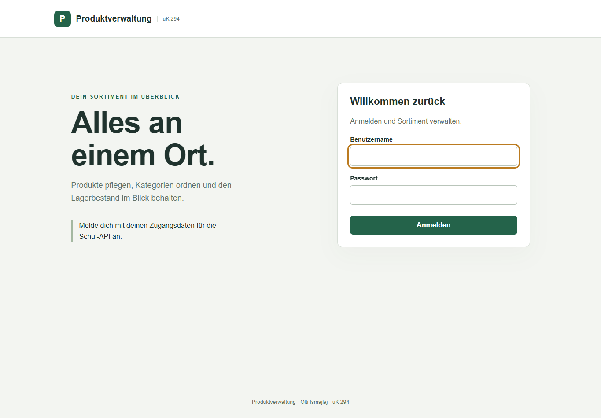
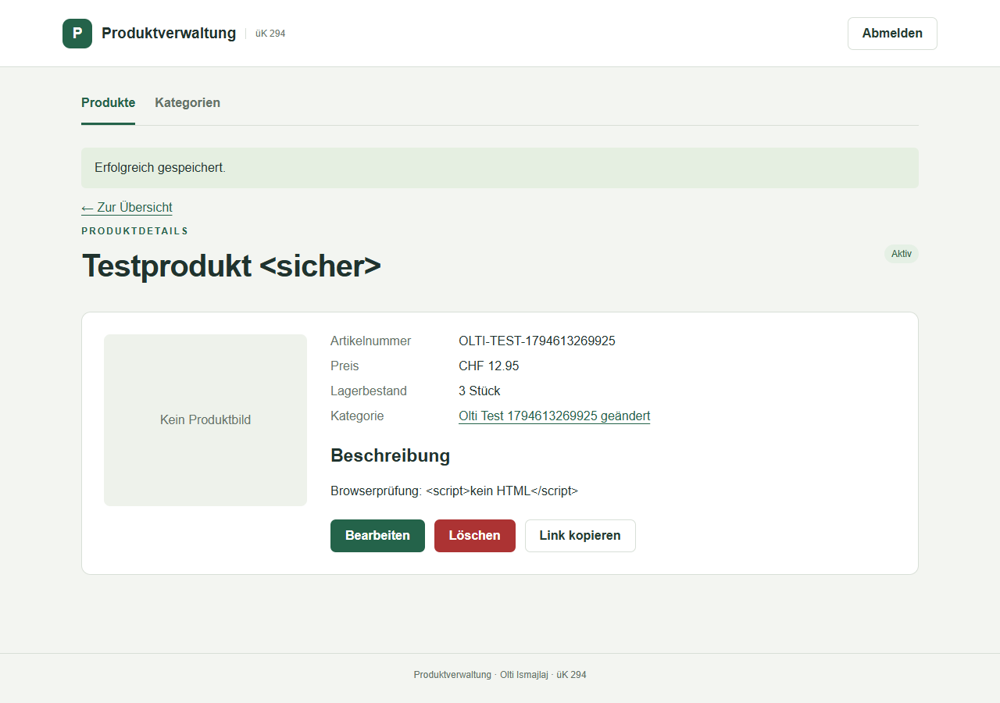
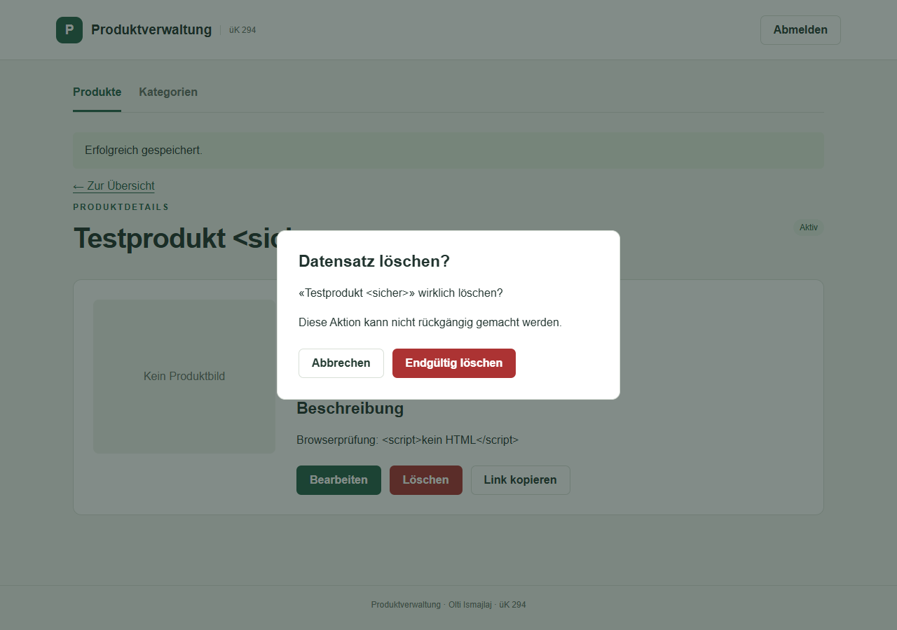

PROJEKTDOKUMENTATION · ÜK 294

Produktverwaltung

Web-Frontend für Produkte und Kategorien

Projekt: Olti Ismajlaj
Dokumentstand / Version: 14.11.2026 / 0.9

Arbeitsfassung: Das persönliche Arbeitsjournal, die Reflexionen sowie die endgültige Abgabeprüfung sind noch zu ergänzen. Die Angaben zu Tätigkeiten aus Git sind nachweisbar; daraus lassen sich keine Arbeitsdauern ableiten.

## Inhalt

| Kapitel | Seite |
| --- | --- |
| 1. Auftrag und Funktionsumfang | 2 |
| 2. Applikationsstruktur und MVC | 3 |
| 3. API, Anmeldung und Sicherheit | 4 |
| 4. Storyboard: Anmeldung und Übersichten | 5 |
| 5. Storyboard: Details und Formulare | 6 |
| 6. Storyboard: Löschen und Sonderfälle | 7 |
| 7. Testprotokoll und Grenzen | 8 |
| 8. Arbeitsjournal und Reflexion | 9 |
| 9. Verzeichnisse, Quellen und Abgabe | 10 |

Lokal starten: Apache in XAMPP einschalten und http://localhost/projekt294/ öffnen. Eine eigene MySQL-Datenbank wird vom Frontend nicht verwendet; die dauerhafte Speicherung übernimmt die vorgegebene REST-API.

## 1. Auftrag und Funktionsumfang

Ziel ist eine verständliche Weboberfläche zur Verwaltung eines Online-Shop-Sortiments. Angemeldete Benutzer können Produkte und Kategorien auflisten, ansehen, erstellen, bearbeiten und löschen. Ohne Anmeldung sind keine Daten abrufbar.

| Nr. | Anforderung und Umsetzung |
| --- | --- |
| 1-2 | Anmeldung über das Loginformular; Abmeldung über die Schaltfläche im Kopfbereich. |
| 3-7 | Produkte: Anlegen mit eindeutiger SKU, Detailansicht, Bearbeiten, bestätigtes Löschen, Liste mit Suche und Statusfilter. |
| 8-12 | Kategorien: Anlegen, Detailansicht, Bearbeiten, bestätigtes Löschen, Liste mit Suche und Statusfilter. |
| 13 | DataController prüft die Sitzung vor jedem Datenabruf und jeder Änderung. Ohne Anmeldung folgt HTTP 401. |
| 14-16 | Web-Applikation mit HTML/CSS/JavaScript; asynchrone fetch-Anfragen; verständliche Beschriftungen, Lade- und Fehlermeldungen. |
| Permalinks | Produkte: index.php?view=product&id=SKU. Kategorien: index.php?view=category&id=ID. Die Kennung wird URL-kodiert. |
| Dokumentation | Aufbau, API, Storyboard, Tests und Journalvorlage. Persönliche Zeitangaben und Reflexionen stehen noch aus. |

Der Umfang folgt dem bereitgestellten Projektauftrag vom 20.10.2026. Das Bewertungsraster enthält 82 Projektpunkte; das Fachgespräch beeinflusst den Faktor. Die technische Umsetzung allein garantiert daher weder eine bestimmte Prozentzahl noch eine Note.

Das Frontend benötigt PHP 8 mit cURL, eine funktionierende Internetverbindung zur Schul-API und einen aktuellen Browser mit aktiviertem JavaScript. CSS und JavaScript liegen lokal; externe Schriftarten oder UI-Bibliotheken sind nicht erforderlich.

## 2. Applikationsstruktur und MVC

Abbildung 1: Datenfluss nach MVC

| Schritt | Verantwortung |
| --- | --- |
| Browser / View | HTML-Ansichten und CSS stellen Informationen dar. app.js reagiert auf Eingaben und ruft lokale Controller per AJAX auf. |
| Controller | AuthController, LogoutController und DataController prüfen Methode, Anmeldung, CSRF-Token und Formulardaten. |
| Model | ApiClient kapselt die HTTP-Aufrufe und die API-Cookies. Er verarbeitet ausserdem die beobachteten Besonderheiten beim Anlegen von Kategorien. |
| Schul-API | Authentifiziert den Benutzer und verwaltet die persistenten Produkte und Kategorien. |
| Rückweg | API-Antwort -> Model -> Controller (JSON/Statuscode) -> app.js aktualisiert die sichtbare Ansicht. |

| Datei / Ordner | Aufgabe |
| --- | --- |
| index.php | Einstiegspunkt und gemeinsamer Seitenrahmen; zeigt abhängig von der Sitzung Login oder Verwaltungsansicht. |
| bootstrap.php | Sitzungsstart, CSRF-Prüfung und gemeinsame JSON-Antworten. |
| controllers/HomeController.php | Bindet die PHP-Views für Anmeldung oder Verwaltung ein. |
| controllers/*Controller.php | Anmeldung, Abmeldung und geschützte Datenoperationen. |
| models/ApiClient.php | Kommunikation mit der REST-API. |
| views/login.php, views/home.php | HTML-Struktur der Benutzeroberfläche und Löschdialog. |
| assets/app.js, assets/style.css | Browserlogik, Navigation, dynamische Darstellung und Gestaltung. |
| tests/browser.cjs, docs/ | Browsertest sowie Projektdokumentation. |

Die Trennung ist pragmatisch: PHP steuert Sitzung und Datenzugriff, JavaScript übernimmt die Interaktion im Browser. Dynamische HTML-Vorlagen sind in app.js zusammengefasst; eine weitere Trennung in View-Module wäre bei wachsendem Umfang sinnvoll.

## 3. API, Anmeldung und Sicherheit

Basisadresse: https://campus.csbe.ch/uek294/api/v1

| Methode | Endpoint | Verwendung |
| --- | --- | --- |
| POST | /authenticate | Zugangsdaten senden; bei Erfolg HTTP 204 und Token-Cookie. |
| POST | /unauthenticate | Abmelden; zusätzlich wird die lokale Sitzung beendet. |
| GET | /products, /categories | Alle Datensätze auflisten. |
| GET | /product/{sku}, /category/{id} | Einzelnen Datensatz lesen. |
| PUT | /product/{sku} | Produkt erstellen oder vollständig ändern. |
| POST | /category | Kategorie erstellen. |
| PATCH | /category/{id} | Kategorie ändern. |
| DELETE | /product/{sku}, /category/{id} | Datensatz löschen. |

Die Zugangsdaten werden nur im Anmeldeformular eingegeben und nicht im Repository gespeichert. PHP empfängt das API-Cookie und hält es serverseitig in der Sitzung. Der Browser erhält lediglich das lokale Sitzungscookie. Nach erfolgreicher Anmeldung wird die Sitzungs-ID erneuert.

Ändernde Anfragen benötigen ein zur Sitzung gehörendes CSRF-Token. Die Controller akzeptieren nur fest definierte Ressourcen und Methoden. Formulardaten werden im Browser und auf dem Server geprüft. Textwerte aus der API werden vor der HTML-Ausgabe maskiert.

Fehler: HTTP 400 kennzeichnet ungültige Angaben, 401 eine fehlende oder abgelaufene Anmeldung, 403 ein ungültiges CSRF-Token und 404 einen nicht gefundenen Datensatz. API-Ausfälle erscheinen als verständliche Fehlermeldung. Bei abgelaufener Anmeldung bleibt die aktuelle Detail-URL erhalten.

Beobachtete API-Abweichung: Das Erstellen einer Kategorie liefert kein Kategorieobjekt und übernimmt den aktiven Status nicht korrekt. Das Model vergleicht die IDs vor und nach dem Anlegen, erkennt den eindeutig neuen Datensatz und korrigiert nötigenfalls den Status per PATCH. Ist die Zuordnung nicht eindeutig, wird keine fremde Kategorie geändert.

Vor einer neuen Produktanlage wird geprüft, ob die SKU bereits existiert. Die API bietet allerdings kein atomisches 'nur anlegen'; bei gleichzeitiger Anlage derselben SKU durch mehrere Benutzer bleibt ein Konkurrenzrisiko.

## 4. Storyboard: Anmeldung und Übersichten

Abbildung 2: Anmeldung auf einem Desktop-Bildschirm.

| Ansicht | Elemente und Interaktionen |
| --- | --- |
| Anmeldung | Benutzername, Passwort, Anmelden und Statusmeldung. Pflichtfelder verhindern leere Eingaben. Während der Anfrage ist die Schaltfläche deaktiviert. Fehler erscheinen im Formular; Erfolg öffnet die angeforderte Verwaltungsansicht. |
| Produktübersicht | Navigation Produkte/Kategorien, Suche nach Name oder SKU, Statusfilter, Anzahl Treffer und Tabelle mit Name, SKU, Preis, Bestand und Status. Name öffnet die Detailseite, Bearbeiten das Formular, Produkt erstellen ein leeres Formular. |
| Kategorienübersicht | Gleiche Bedienung wie bei Produkten. Die Tabelle zeigt Name, ID, Status und Bearbeiten. Kategorie erstellen öffnet das Anlageformular. |
| Leere Liste / Suche | Eine Meldung erklärt, dass keine Einträge gefunden wurden. Der Benutzer kann die Suche zurücksetzen, den Filter ändern oder einen Eintrag erstellen. |
| Abmelden | Die Schaltfläche im Kopfbereich beendet die lokale Anmeldung und führt zur Loginseite zurück. |

Übergänge: Login -> Produktübersicht bzw. zuvor angeforderter Direktlink. Produktübersicht <-> Kategorienübersicht. Übersicht -> Details oder Formular. Browser-Zurück/Vorwärts lädt die zur URL passende Ansicht.

## 5. Storyboard: Details und Formulare

Abbildung 3: Produktdetail mit eindeutigem Link und Aktionen.

| Ansicht | Elemente, Aktionen und Übergänge |
| --- | --- |
| Produktdetails | Name, Status, SKU, Bild oder Platzhalter, Preis, Lagerbestand, Kategorienlink und Beschreibung. Bearbeiten öffnet das vorausgefüllte Formular, Löschen den Dialog, Link kopieren kopiert die aktuelle Adresse. Zur Übersicht führt zur Produktliste. |
| Produkt erstellen | SKU und Name, Status, Kategorie, Preis, Bestand, optionale Bildadresse und Beschreibung. Speichern validiert die Eingaben und ruft PUT auf. Bei Erfolg folgt die Detailseite. Bei Fehler bleiben die Eingaben erhalten. |
| Produkt bearbeiten | Die gleichen Felder sind vorausgefüllt; SKU ist schreibgeschützt, damit der Direktlink stabil bleibt. Änderungen speichern aktualisiert den Datensatz und öffnet die Detailansicht. Abbrechen verwirft die nicht gespeicherten Eingaben. |
| Kategoriedetails | Name, Status, Kategorie-ID, Bearbeiten, Löschen und Link kopieren. Zurück führt zur Kategorienübersicht. |
| Kategorie erstellen / bearbeiten | Name und Status. Erstellen legt einen Datensatz an; Bearbeiten übernimmt die ID. Erfolg führt zur Detailansicht, Fehler erhält die Eingaben. Abbrechen führt zur vorherigen Ansicht. |

Validierung: Namen dürfen nicht leer sein. Preise und Bestände sind nicht negativ; der Bestand ist ganzzahlig. Eine Kategorie muss gewählt werden. Bildadressen müssen HTTP oder HTTPS verwenden. Neue SKUs dürfen keine Leerzeichen oder Pfadsonderzeichen enthalten; vorhandene SKUs bleiben unverändert.

## 6. Storyboard: Löschen und Sonderfälle

Abbildung 4: Löschbestätigung mit benanntem Datensatz.

| Zustand | Verhalten |
| --- | --- |
| Löschbestätigung | Der Dialog nennt den Datensatz und weist auf die endgültige Löschung hin. Abbrechen oder Escape schliesst den Dialog ohne Änderung. Endgültig löschen sendet DELETE und deaktiviert die Bedienelemente während der Anfrage. |
| Erfolgreiche Löschung | Der Dialog schliesst sich. Die aktuelle Liste wird neu geladen und zeigt eine Erfolgsmeldung. Der alte Direktlink liefert anschliessend eine Nicht-gefunden-Meldung. |
| Fehler beim Löschen | Der Dialog bleibt offen und zeigt eine verständliche Meldung. Die Aktion kann erneut versucht oder abgebrochen werden. |
| Fehlender Datensatz / ungültige Ansicht | Eine Fehleransicht bietet Erneut versuchen sowie Links zu beiden Übersichten. |
| Abgelaufene Anmeldung | Die API-Antwort 401 entfernt die lokale API-Anmeldung. Die Loginseite erscheint mit Hinweis; die angeforderte URL bleibt erhalten. |
| Bild nicht erreichbar | Ein Platzhalter ersetzt das defekte Bild. Der übrige Datensatz bleibt bedienbar. |
| Schmaler Bildschirm | Formulare und Detailansichten wechseln zu einer Spalte. Breite Tabellen sind innerhalb ihres Bereichs horizontal scrollbar. |

Eine Kategorie kann von Produkten referenziert werden. Vor dem Löschen weist die Oberfläche auf diese Abhängigkeit hin. Das endgültige Verhalten bei vorhandenen Referenzen bestimmt die Schul-API.

## 7. Testprotokoll und Grenzen

Testumgebung: Windows, XAMPP / PHP 8.2.12, Microsoft Edge im automatisierten Test, echte Schul-API. Teststand: 14.11.2026. Für die Schreibtests werden eindeutig benannte Testdaten verwendet und anschliessend entfernt.

| Prüfung | Erwartetes Ergebnis |
| --- | --- |
| Syntax PHP / JavaScript | Alle PHP-Dateien bestehen php -l; app.js besteht node --check. |
| Zugriff ohne Anmeldung | Direkter Datenabruf erhält HTTP 401. |
| Anmeldung und Neuladen | Erfolgreiche Anmeldung bleibt nach Neuladen erhalten. |
| Listen und Details | Echte Produkt- und Kategorienlisten sowie Einzelabrufe liefern HTTP 200. |
| Validierung / CSRF | Ungültige Felder werden mit 400, falsche CSRF-Token mit 403 abgewiesen. |
| Kategorie CRUD | Anlegen inklusive aktivem Status, Detailabruf, Ändern und Löschen funktionieren. |
| Produkt CRUD | Anlegen mit Kategorie, Lesen, Preisänderung, Abbrechen der Löschung und endgültiges Löschen funktionieren. |
| Permalink und Textausgabe | Neuladen einer Detail-URL erhält den Datensatz; HTML-Zeichen erscheinen als Text. |
| Mobile Ansicht / JavaScript | Detailansicht bei 390 Pixeln ohne Seitenüberlauf; keine unbehandelten JavaScript-Fehler. |
| Abmeldung | Nach Logout sind Daten wieder mit HTTP 401 geschützt. |

Die Ergebnisse der letzten Testausführung stehen in tests/TESTERGEBNISSE.md. Das Skript tests/browser.cjs prüft die Kernabläufe mit Assertions. Zugangsdaten werden ausschliesslich über Umgebungsvariablen übergeben.

Grenzen: Die Anwendung ist von der Verfügbarkeit und dem Verhalten der Schul-API abhängig. Parallele Änderungen mehrerer Benutzer werden nicht versioniert. Die API kann Kategorien referenzierter Produkte löschen oder Änderungen ablehnen. Nicht sämtliche denkbaren Netzwerkfehler und Konkurrenzsituationen wurden automatisiert geprüft.

Vor Abgabe zusätzlich manuell prüfen: Fachgespräch vorbereiten, alle Felder selbst erklären, Bedienung ausschliesslich per Tastatur, aktuelle Repository-Sichtbarkeit und tatsächlicher Abgabetermin.

## 8. Arbeitsjournal und Reflexion

Die folgende Vorlage enthält nur belegbare Tätigkeiten. Die persönlichen Arbeitszeiten und Reflexionen müssen von Olti ergänzt werden. Commit-Uhrzeiten belegen Speicherstände, nicht die gesamte Arbeitsdauer. Tage ohne Arbeit benötigen keine fingierten Tätigkeiten.

| Datum / Beleg | Nachweisbare Tätigkeit | Zeit |
| --- | --- | --- |
| 07.11.2026, 09:42 1d452f8 | Projektstruktur erstellt. | Noch ergänzen |
| 07.11.2026, 09:58 68d55a5 | Startseite und HomeController erstellt. | Noch ergänzen |
| 07.11.2026, 10:52 186b0d2 | Login mit API und Fehlerbehandlung gespeichert. | Noch ergänzen |
| 14.11.2026 Aktueller Projektstand | Anmeldeablauf, API-Zugriff, Produkt-/Kategorienverwaltung, Eingabeprüfung, Permalinks, Oberfläche, Tests und Dokumentationsentwurf ergänzt. | Eigene Prüf- und Lernzeit ergänzen |

## Reflexion pro tatsächlichem Arbeitstag

07.11.2026 - Eigene Reflexion ergänzen: Was gelang beim Aufbau? Was war beim Login schwierig? Wie wurde das Problem untersucht? Welche Erkenntnis hilft beim nächsten Arbeitsschritt?

14.11.2026 - Eigene Reflexion ergänzen: Welche Änderungen wurden selbst nachvollzogen und getestet? Welche Zusammenhänge zwischen View, Controller und Model sind klar? Was muss für das Fachgespräch noch geübt werden?

## Weitere Arbeitstage

| Datum | Tätigkeit | Dauer | Eigene Reflexion |
| --- | --- | --- | --- |
| Ausfüllen | Nur tatsächlich geleistete Arbeit eintragen | Ausfüllen | Ergebnis, Schwierigkeiten, nächste Schritte |

Hinweis zur Planung: Sinnvolle nächste Arbeitsschritte sind das eigenständige Prüfen jeder Funktion, das Ergänzen der Dokumentation und das Vorbereiten des Fachgesprächs. Diese Planung ist kein Nachweis bereits geleisteter Arbeit.

## 9. Verzeichnisse, Quellen und Abgabe

## Abbildungsverzeichnis

Abbildung 1: Datenfluss nach MVC, Seite 3.
Abbildung 2: Anmeldung, Seite 5.
Abbildung 3: Produktdetails, Seite 6.
Abbildung 4: Löschbestätigung, Seite 7.

## Tabellenverzeichnis

Inhaltsübersicht, Seite 1; Anforderungsübersicht, Seite 2; Datenfluss und Dateistruktur, Seite 3; API-Endpunkte, Seite 4; Storyboard-Tabellen, Seiten 5 bis 7; Testfälle, Seite 8; Arbeitsjournal und Vorlage, Seite 9.

## Quellenverzeichnis

## Abgabecheckliste

1. Persönliches Journal mit tatsächlichen Zeiten und eigenen Reflexionen vervollständigen.
2. Dokumentation gegen den letzten Projektstand prüfen und PDF erneut erzeugen.
3. Anwendung selbst bedienen und den Code für das Fachgespräch erklären können.
4. Änderungen mit sinnvoller Commit-Nachricht speichern und in das vorgesehene Repository übertragen.
5. Prüfen, dass alle geforderten Web-Dateien enthalten sind und das Repository wie verlangt öffentlich ist.
6. PDF und Repository-Link vor der konkreten Unterrichtsfrist im vorgegebenen Teams-Chat abgeben.

Die Abgabe über Teams erfolgt separat. Eine endgültige Vollständigkeitsprüfung ist nach Ergänzung des persönlichen Journals notwendig.
